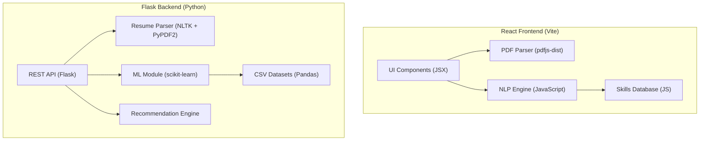
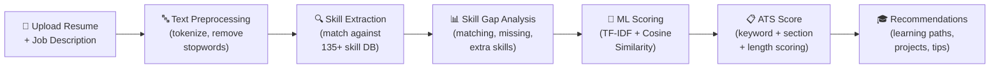

# SmartHireAI — Project Walkthrough (Presentation Guide)

> **AI-Powered Reverse Resume Builder for Skill Gap Analysis**

---

## 🏗️ Architecture Overview

The project has **two independent versions** that can run separately:
1. **React Frontend** — fully client-side, runs in the browser (no backend needed)
2. **Flask Backend** — serves its own HTML frontend + REST API

---

## 📂 File-by-File Breakdown

### 🔷 React Frontend (`reverse-resume-builder-react/`)

| File | What It Does | Technologies / Concepts Used |
|------|-------------|------------------------------|
| [index.html](file:///c:/Users/laksh/Desktop/Ai%20powered%20resume%20for%20skill%20gap%20analysis/reverse-resume-builder-react/index.html) | Entry point, loads fonts, SEO meta tags | HTML5, Google Fonts (Inter) |
| [vite.config.js](file:///c:/Users/laksh/Desktop/Ai%20powered%20resume%20for%20skill%20gap%20analysis/reverse-resume-builder-react/vite.config.js) | Build tool configuration | **Vite** (fast bundler), React plugin |
| [main.jsx](file:///c:/Users/laksh/Desktop/Ai%20powered%20resume%20for%20skill%20gap%20analysis/reverse-resume-builder-react/src/main.jsx) | React app bootstrap | **React 19**, ReactDOM |
| [index.css](file:///c:/Users/laksh/Desktop/Ai%20powered%20resume%20for%20skill%20gap%20analysis/reverse-resume-builder-react/src/index.css) | Full styling — dark theme, glassmorphism, animations | **CSS3** — gradients, `backdrop-filter`, keyframe animations, CSS Grid, Flexbox, media queries |
| [App.jsx](file:///c:/Users/laksh/Desktop/Ai%20powered%20resume%20for%20skill%20gap%20analysis/reverse-resume-builder-react/src/App.jsx) | Main app logic — orchestrates analysis pipeline | **React Hooks** (`useState`, `useRef`), component composition |

---

#### 🧩 Components (`src/components/`)

| Component | Purpose | Key Concepts |
|-----------|---------|-------------|
| [Header.jsx](file:///c:/Users/laksh/Desktop/Ai%20powered%20resume%20for%20skill%20gap%20analysis/reverse-resume-builder-react/src/components/Header.jsx) | Logo, hero section, floating skill cards | SVG graphics, CSS animations |
| [InputSection.jsx](file:///c:/Users/laksh/Desktop/Ai%20powered%20resume%20for%20skill%20gap%20analysis/reverse-resume-builder-react/src/components/InputSection.jsx) | PDF upload + text input for resume & JD | **pdfjs-dist** (Mozilla's PDF.js), drag-and-drop API, `FileReader`, `ArrayBuffer`, form handling |
| [ResultsSection.jsx](file:///c:/Users/laksh/Desktop/Ai%20powered%20resume%20for%20skill%20gap%20analysis/reverse-resume-builder-react/src/components/ResultsSection.jsx) | Container that shows all result panels | Conditional rendering, props passing |
| [ScoreCards.jsx](file:///c:/Users/laksh/Desktop/Ai%20powered%20resume%20for%20skill%20gap%20analysis/reverse-resume-builder-react/src/components/ScoreCards.jsx) | Animated score gauges (Match %, Similarity, ATS) | **SVG circle animations** (`stroke-dasharray`), `useEffect` for animated counters |
| [SkillsDisplay.jsx](file:///c:/Users/laksh/Desktop/Ai%20powered%20resume%20for%20skill%20gap%20analysis/reverse-resume-builder-react/src/components/SkillsDisplay.jsx) | Matching / Missing / Extra skill chips by category | Object iteration, dynamic CSS classes |
| [PriorityRanking.jsx](file:///c:/Users/laksh/Desktop/Ai%20powered%20resume%20for%20skill%20gap%20analysis/reverse-resume-builder-react/src/components/PriorityRanking.jsx) | High / Medium / Low skill importance | Color-coded priority system |
| [ATSBreakdown.jsx](file:///c:/Users/laksh/Desktop/Ai%20powered%20resume%20for%20skill%20gap%20analysis/reverse-resume-builder-react/src/components/ATSBreakdown.jsx) | ATS score breakdown (keyword, sections, length) | Progress bars, score visualization |
| [LearningPath.jsx](file:///c:/Users/laksh/Desktop/Ai%20powered%20resume%20for%20skill%20gap%20analysis/reverse-resume-builder-react/src/components/LearningPath.jsx) | Personalized learning roadmap for missing skills | Collapsible cards, step-by-step layout |
| [ProjectSuggestions.jsx](file:///c:/Users/laksh/Desktop/Ai%20powered%20resume%20for%20skill%20gap%20analysis/reverse-resume-builder-react/src/components/ProjectSuggestions.jsx) | Suggested projects to build | Difficulty badges, card layout |
| [ResumeTips.jsx](file:///c:/Users/laksh/Desktop/Ai%20powered%20resume%20for%20skill%20gap%20analysis/reverse-resume-builder-react/src/components/ResumeTips.jsx) | Actionable resume improvement tips | Priority-based sorting |
| [ParticleBackground.jsx](file:///c:/Users/laksh/Desktop/Ai%20powered%20resume%20for%20skill%20gap%20analysis/reverse-resume-builder-react/src/components/ParticleBackground.jsx) | Animated background particles | **HTML5 Canvas API**, `requestAnimationFrame`, trigonometry for movement |

---

#### 🧠 NLP Engine (`src/engine/`) — *Where the AI/ML happens*

##### 1. [resumeParser.js](file:///c:/Users/laksh/Desktop/Ai%20powered%20resume%20for%20skill%20gap%20analysis/reverse-resume-builder-react/src/engine/resumeParser.js) — Text Preprocessing
- **Concept**: NLP Text Preprocessing Pipeline
- **What it does**:
  - Converts text to lowercase
  - Removes URLs and emails using **Regex**
  - **Tokenization** — splits text into words
  - **Stopword Removal** — removes common English words ("the", "is", "and") using a hardcoded stopword list (equivalent to NLTK's stopwords)
  - Section Detection — identifies resume sections (Education, Experience, Skills, etc.) by keyword matching

##### 2. [skillExtractor.js](file:///c:/Users/laksh/Desktop/Ai%20powered%20resume%20for%20skill%20gap%20analysis/reverse-resume-builder-react/src/engine/skillExtractor.js) — Skill Extraction
- **Concept**: NLP Keyword Matching / Named Entity Recognition (simplified)
- **What it does**:
  - Matches text against a **master skill database** (135+ skills across 14 categories)
  - Uses **substring matching** for multi-word skills (e.g., "machine learning")
  - Uses **exact word matching** for short skills (e.g., "C", "R") to avoid false positives
  - Categorizes skills into groups: Programming, Web Dev, AI & ML, Cloud, etc.

##### 3. [model.js](file:///c:/Users/laksh/Desktop/Ai%20powered%20resume%20for%20skill%20gap%20analysis/reverse-resume-builder-react/src/engine/model.js) — ML Scoring Module ⭐
- **Concept**: TF-IDF Vectorization + Cosine Similarity
- **What it does**:

  **TF-IDF (Term Frequency–Inverse Document Frequency)**:
  - [computeTF()](file:///c:/Users/laksh/Desktop/Ai%20powered%20resume%20for%20skill%20gap%20analysis/reverse-resume-builder-react/src/engine/model.js#25-40) — Calculates how often each word appears in a document (normalized)
  - [computeIDF()](file:///c:/Users/laksh/Desktop/Ai%20powered%20resume%20for%20skill%20gap%20analysis/reverse-resume-builder-react/src/engine/model.js#41-69) — Measures how rare/important a word is across documents using formula: `log((N+1)/(count+1)) + 1`
  - [buildTFIDFVector()](file:///c:/Users/laksh/Desktop/Ai%20powered%20resume%20for%20skill%20gap%20analysis/reverse-resume-builder-react/src/engine/model.js#70-81) — Combines TF × IDF to create a numerical vector for each document

  **Cosine Similarity**:
  - [cosineSimilarity()](file:///c:/Users/laksh/Desktop/Ai%20powered%20resume%20for%20skill%20gap%20analysis/reverse-resume-builder-react/src/engine/model.js#82-107) — Measures the angle between two TF-IDF vectors using: `dotProduct / (|A| × |B|)`
  - Score ranges from 0 (no match) to 1 (perfect match)

  **ATS Score Calculation** (out of 100):
  - Keyword Match (40 pts) — percentage of JD skills found in resume
  - Section Presence (30 pts) — checks for Education, Experience, Skills, Projects, Summary, Contact
  - Resume Length (15 pts) — optimal range 300–1500 words
  - Skill Coverage (15 pts) — total skills mentioned (8+ = full marks)

  **Skill Importance Ranking**:
  - Uses TF weights from job description to rank skills as High / Medium / Low priority

##### 4. [recommendation.js](file:///c:/Users/laksh/Desktop/Ai%20powered%20resume%20for%20skill%20gap%20analysis/reverse-resume-builder-react/src/engine/recommendation.js) — Recommendation Engine
- **Concept**: Rule-based Recommendation System
- **What it does**:
  - **Learning Paths** — maps 20+ skills to curated resources, platforms, estimated time, and step-by-step plans
  - **Project Suggestions** — recommends beginner/intermediate projects for each missing skill
  - **Resume Tips** — analyzes resume for missing sections, action verbs, quantification, links, and length

---

#### 📊 Data Layer (`src/data/`)

| File | Contents | Details |
|------|----------|---------|
| [skillsData.js](file:///c:/Users/laksh/Desktop/Ai%20powered%20resume%20for%20skill%20gap%20analysis/reverse-resume-builder-react/src/data/skillsData.js) | **SKILLS_DB** — 135+ skills in 14 categories | Programming, Web Dev, Database, Cloud & DevOps, AI & ML, Core CS, Methodology, Soft Skills, Security, Testing, Data & Analytics, Mobile Dev, Design, Emerging Tech |
| [skillsData.js](file:///c:/Users/laksh/Desktop/Ai%20powered%20resume%20for%20skill%20gap%20analysis/reverse-resume-builder-react/src/data/skillsData.js) | **JOB_ROLES** — 12 roles with prioritized skills | Software Dev, Frontend, Backend, Full Stack, Data Scientist, Data Analyst, ML Engineer, DevOps, Cloud Engineer, Mobile Dev, Cybersecurity Analyst, AI Engineer |

---

### 🔶 Flask Backend (`reverse-resume-builder/backend/`)

| File | What It Does | Technologies / Libraries |
|------|-------------|------------------------|
| `app.py` | Main Flask server, `/analyze` API endpoint, serves frontend | **Flask** (web framework), REST API, JSON responses |
| `resume_parser.py` | PDF text extraction + NLP preprocessing | **PyPDF2** (PDF reading), **NLTK** (tokenization, stopword removal), Regex |
| `skill_extractor.py` | Loads skill DB from CSV, extracts & categorizes skills | **Pandas** (DataFrame operations), CSV parsing |
| `model.py` | TF-IDF + Cosine Similarity (ML module) | **scikit-learn** (`TfidfVectorizer`, `cosine_similarity`), n-grams (unigrams + bigrams) |
| `recommendation.py` | Learning paths, project suggestions, resume tips | Rule-based engine, string analysis |

---

### 📁 Datasets (`reverse-resume-builder/data/`)

| File | Format | Contents |
|------|--------|----------|
| `skills.csv` | CSV (skill, category) | 135 skills across 14 categories |
| `job_roles.csv` | CSV (role, skill, priority) | 12 job roles, each with High/Medium/Low priority skills |

---

## 🔬 Key Algorithms & Concepts Summary

| Concept | Where Used | Explanation |
|---------|-----------|-------------|
| **TF-IDF** | `model.js`, `model.py` | Converts text to numerical vectors based on word importance |
| **Cosine Similarity** | `model.js`, `model.py` | Measures similarity between resume and JD vectors (0 to 1) |
| **NLP Preprocessing** | `resumeParser.js`, `resume_parser.py` | Tokenization, stopword removal, text cleaning |
| **Keyword Extraction** | `skillExtractor.js`, `skill_extractor.py` | Pattern matching against a skill database |
| **ATS Scoring** | `model.js`, `model.py` | Multi-factor scoring (keywords, sections, length, coverage) |
| **Recommendation System** | `recommendation.js`, `recommendation.py` | Rule-based skill-to-resource mapping |
| **PDF Parsing** | `InputSection.jsx`, `resume_parser.py` | Client: pdfjs-dist, Server: PyPDF2 |

---

## 🛠️ Tech Stack Summary

| Layer | Technology | Purpose |
|-------|-----------|---------|
| **Frontend Framework** | React 19 + Vite 8 | Component-based UI, fast HMR |
| **Styling** | Vanilla CSS3 | Dark theme, glassmorphism, animations |
| **PDF Parsing (Client)** | pdfjs-dist (Mozilla PDF.js) | Extract text from uploaded PDFs |
| **Backend Framework** | Flask (Python) | REST API server |
| **NLP (Server)** | NLTK | Tokenization, stopword removal |
| **ML (Server)** | scikit-learn | TF-IDF vectorization, cosine similarity |
| **PDF Parsing (Server)** | PyPDF2 | Server-side PDF text extraction |
| **Data Processing** | Pandas | Load and process CSV skill databases |
| **Fonts** | Google Fonts (Inter) | Modern typography |

---

## 🎯 How the Analysis Pipeline Works

**Step-by-step:**
1. **Input** — User uploads PDF resume + pastes job description
2. **Preprocessing** — Remove URLs, emails, stopwords; tokenize text
3. **Skill Extraction** — Match preprocessed text against 135+ skill database
4. **Gap Analysis** — Compare resume skills vs JD skills → matching, missing, extra
5. **ML Similarity** — TF-IDF vectorize both texts → compute cosine similarity score
6. **ATS Scoring** — Calculate 100-point score (keywords 40 + sections 30 + length 15 + coverage 15)
7. **Skill Ranking** — Rank all JD skills by TF-IDF importance (High/Medium/Low)
8. **Recommendations** — Generate learning paths, project suggestions, and resume improvement tips
